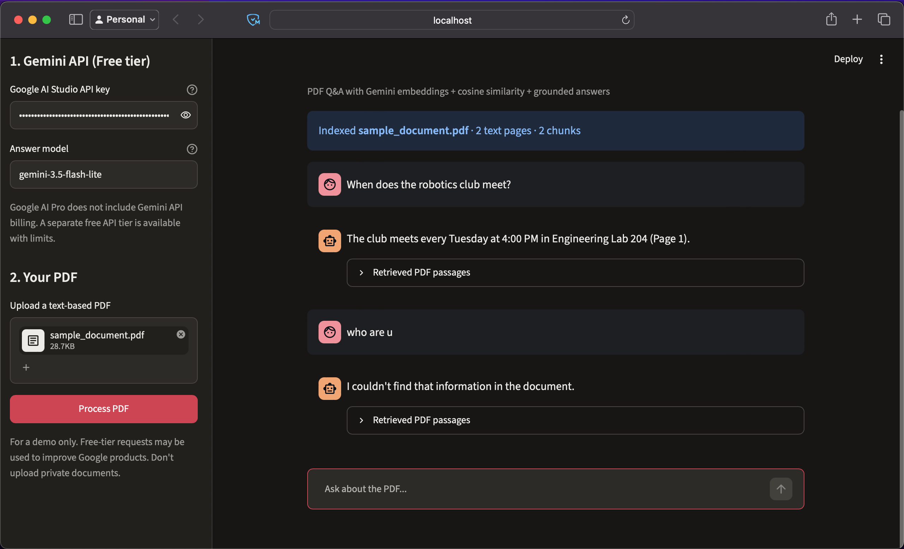

# Document Lens — Free-Tier Gemini RAG Chatbot

**A small PDF Q&A portfolio project for an AI Engineer interview.** It lets you upload a PDF, generate embeddings, search relevant passages by vector similarity, and ask Gemini to answer with page citations.


## Demo Screenshot




## Cost and subscription note

- **Gemini API Free tier:** Google AI Studio offers limited free access to select Gemini models and embedding models. Free-tier access, quotas and availability vary by project, account, region and model; consult the AI Studio quota dashboard.
- **Google AI Pro:** A consumer subscription is **not** a prepaid Gemini API allowance. You can still obtain a separate Free-tier API key even without Pro, subject to eligibility and limits.
- **No need to enable billing** to try the Free-tier API. Do not attach a billing account to the project if you want to avoid API charges.
- **Privacy:** Free-tier content may be used by Google to improve its products. Use fictional/demo PDFs only.

Official reference: https://ai.google.dev/gemini-api/docs/pricing

## 1. Get a free API key

1. Visit **https://aistudio.google.com/api-keys** and sign in.
2. Create/copy an API key in a **Free-tier project**, if your account is eligible.
3. Do not enable paid API billing.
4. If a model isn't available, see **https://aistudio.google.com/rate-limit** or use another free-supported model listed in your account.

## 2. Run on Mac

You need Python 3.10+ (Python 3.11/3.12 recommended).

```bash
cd rag-pdf-chatbot-gemini
python3 -m venv .venv
source .venv/bin/activate
pip install -r requirements.txt
cp .env.example .env
```

Open `.env` in your preferred editor and replace `paste-your-google-ai-studio-key-here` with your key. Do not publish it.

```bash
streamlit run app.py
```

Windows: activate with `.venv\Scripts\activate` and copy the file using `copy .env.example .env`.

## 3. Demo

Upload the included `sample_document.pdf`, click **Process PDF**, and try:

- **When does the robotics club meet?** (Tuesday, 4 PM)
- **What is the annual membership fee?** (PKR 1,200)
- **What sensor is used for obstacle detection?** (HC-SR04)
- **Who founded the robotics club?** (not supplied; should refuse to invent it)

The app reveals which PDF chunks were used and shows cosine similarity scores.

## 4. The RAG pipeline (know this for the interview)

1. `pypdf` extracts page text, retaining page numbers.
2. We split each page into overlapping ~140-word chunks (25-word overlap).
3. The Gemini `gemini-embedding-001` model converts chunks into 768-dimensional vectors (`RETRIEVAL_DOCUMENT` task type).
4. The vectors are held **in memory** in NumPy arrays; this small demo has no persistent vector database.
5. Each question gets a compatible vector (`RETRIEVAL_QUERY` task type).
6. Cosine similarity ranks all stored chunks; the top 3 passages are retrieved.
7. `gemini-3.5-flash-lite` generates an answer *only from the retrieved context*, with page references.

**Why not just send the entire PDF to Gemini?** RAG first finds relevant passages, sends less context for each question, shows supporting evidence, and gives a foundation for retrieval over larger document collections.

**What would you improve in production?** Persistent Chroma/pgvector; hybrid retrieval and reranking; better chunking; OCR; per-user access control; prompt-injection defenses; retrieval/answer evaluation; quota monitoring.

**Limitations:** The model can still hallucinate or cite weak evidence, especially for questions not in the PDF. Similarity scores are not answer confidence. PDF must contain selectable text. 80-chunk cap is intentional for a fast demo. Embeddings are recomputed if the Streamlit session resets.

## Tests

```bash
python -m unittest discover -s tests -v
```

The tests use fake API responses and run without a Gemini API key. The live API path needs an actual free-tier API key and network access to verify.

## 30-second interview pitch

> “I built a RAG-based PDF assistant using Python, Streamlit, and Gemini. I extract and chunk documents, embed the chunks and user question with task-optimized embedding modes, and use cosine similarity to retrieve the top evidence. I then ask Gemini to answer from those passages and cite pages. I kept retrieval logic explicit instead of hiding it behind LangChain so I could explain and test the entire pipeline.”
